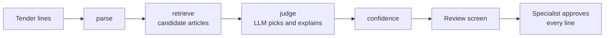

**Stack:** JavaScript · LLM via OpenRouter · ETIM classification (bSDD) · Plain-JS web UI
**Repo:** private (team repository)
**Event:** Ahlsell & Microsoft AI Blueprint Hackathon, 2026, hosted with 2Hero. Third place. I led the team.

## Problem

Challenge 4 was to go from a floor plan to an order-ready Bill of Materials. The slow, error-prone step is the match between a line in a tender document and an article in the supplier's catalogue. A tender line says what the building needs in the contractor's words. The catalogue lists thousands of articles with their own names, and some lines need a special order that has no catalogue match at all.

We scoped Glass to that one step. It is an assistant for the specialist who prices the tender, not a replacement for them.

## Approach

For every tender line Glass suggests an Ahlsell article, offers an own-brand alternative when one exists, explains the match in plain language, and marks the line "Needs your decision" when it is not sure. A specialist approves every line. Auto-accept exists only as an evaluation metric: it measures how many lines the tool would have been safe to pass without review.

I led the team on user needs, requirements and architecture. The code was shared, AI-assisted work across the team.

## Architecture

**Flow:** `parse` reads a tender line into a structured request. `retrieve` finds candidate articles in the catalogue, using ETIM product classification data (via bSDD). `judge` asks an LLM to choose among the candidates and write the reason. `confidence` decides whether the line is shown as likely, or as "Needs your decision", for example when the item looks like a special order. The LLM client caches responses on disk and stops at a fixed budget of $35, so an evaluation run cannot overspend.

## Why this stack

- **Retrieve, then judge:** search narrows the catalogue cheaply and the LLM only reads a short list, which keeps the cost per line low and the reasoning checkable.
- **A rules baseline:** the existing mapping rules gave us something to beat, so the result is a comparison and not a demo.
- **Disk cache and a budget stop:** repeated evaluation runs stay cheap and reproducible.
- **Plain JavaScript UI:** three screens (Review, Building 3D, Ask 3D room) with no framework to set up in a hackathon.

## Results

I scored Glass on 76 gold-labelled lines from four real projects, against a 7,847-article catalogue snapshot.

| method | line accuracy |
|---|---|
| keyword search | 22% |
| rules baseline | 38% |
| Glass (`gpt-5.4`, prompt v2) | 50% |

- **Special orders:** Glass flagged 13 of 14 special-order rows (93%) for a human decision instead of forcing a match.
- **In-catalogue lines:** the top suggestion was right on 47% of them.
- **Auto-accept:** the lines Glass marks green are 13% of all lines, at 70% precision. This is why a specialist still approves everything.
- **Model cost:** with the first prompt, `gpt-5.4` and `gpt-5.5` both scored 49%, at $0.0141 and $0.0524 per line. The cheaper model was enough.

Caveats:

- The rules baseline was tuned on two of the four projects, so its number is not clean.
- I wrote the v2 judge prompt after seeing the first run, so the 50% is not a blind result.
- Own-brand alternatives exist for 10 of the 76 lines, and the app shows 7 of them.
- "Ask 3D room" is a scripted mock-up and makes no model call.
- The catalogue has since grown to 43,121 articles. I did not re-run anything on it.

## What I learned

- **The honest metric is "what can be skipped".** Line accuracy alone hides the useful part: knowing which lines need a human.
- **Flagging beats guessing.** A flagged special order gets a human decision instead of a wrong match, and Glass caught 13 of 14.
- **Compare against a baseline you did not tune.** Mine was tuned on two of the four projects, so its number is not clean.
- **A cheaper model can be the right call.** About 3.7 times the cost per line bought no accuracy.
- **Leading the team:** I set the user, the one decision the tool supports and the evaluation set, and the rest of the work built on those.
