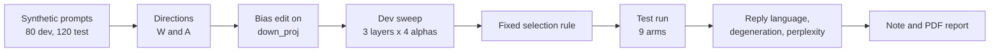

**Stack:** Python · PyTorch · Hugging Face Transformers · Qwen3.5-0.8B · lingua · pandas · Docker · Make
**Repo:** [github.com/PranavC225/sellma-swedish-routing](https://github.com/PranavC225/sellma-swedish-routing)
**Context:** Candidate assignment for SE.LLMA (weight-space programming), November 2026. A research note with code, not a hackathon.

## Problem

The weight-space programming post reports that small edits to a model's weights can change behaviour a lot: Qwen3.5-0.8B on MATH-500 goes from 7.9% to 48.1% after an edit found with 50 forward passes. These are the post's figures, not my measurements. The page shows no variance or confidence intervals for the LLM results and no random-direction control. So the evidence cannot separate "this direction matters" from "any edit of this size moves the model".

I built that control into a small question of my own. Small models often answer in English when asked in another language. Can a rank-1 edit make a small model reply in Swedish when the prompt is Swedish, without making it reply in Swedish to English prompts?

## Approach

The edit is a bias on the MLP `down_proj` of one layer. That is equivalent to adding a fixed steering vector `alpha * R_L * unit(d)` to the residual stream, where `R_L` is the median residual norm at layer L and `d` is a direction. I compared two ways of getting `d`:

- **W (weight-only):** the mean input-embedding row of Swedish word tokens minus the same for English. No forward pass.
- **A (activation difference):** the mean hidden state on Swedish dev prompts minus English dev prompts.

The hypotheses, the config and the selection rule were written down in `PREREG.md` and committed before the test run. The design has 200 synthetic prompt pairs (80 dev, 120 test), a prompt baseline, three random directions at the same norm, Wilson 95% intervals, and exact McNemar tests against the base model.

## Architecture

**Flow:** `make all` runs every stage in Docker, from data generation through the pilot, edit check, calibration, direction extraction, dev sweep, test run, figures and report. Each stage is also a single `make` target. Reply language is classified with lingua restricted to five languages, a reply is degenerate if its share of unique word bigrams is below 0.3, and perplexity is measured on Wikipedia passages.

## Why this stack

- **A 0.8B model:** the whole test run, nine arms, takes 538 seconds on a laptop RTX 5050, so every claim can be re-run.
- **A bias on `down_proj`:** it is a real weight edit and it equals a steering vector, so one change can be described both ways and checked against a forward-hook version.
- **Docker and a pinned model revision:** the result does not depend on my machine.

## Results

Test set, 120 pairs. The `sv-rate` columns show the share of replies classified as Swedish. The `p` columns are exact McNemar tests of each arm against the base model on the same prompts.

| arm | sv-rate, Swedish prompts | sv-rate, English prompts | p vs base, Swedish prompts | p vs base, English prompts | degenerate | Swedish perplexity |
|---|---|---|---|---|---|---|
| base | 1.000 | 0.000 | 1 | 1 | 0.000 | 17.86 |
| prompt | 1.000 | 0.900 | 1 | 6.16e-33 | 0.008 | 17.86 |
| W, pre-registered | 0.925 | 0.000 | 0.00391 | 1 | 0.008 | 26.95 |
| A, pre-registered | 0.967 | 0.717 | 0.125 | 2.58e-26 | 0.179 | 32.51 |
| W, dev-tuned | 1.000 | 0.000 | 1 | 1 | 0.000 | 18.28 |
| A, dev-tuned | 1.000 | 0.025 | 1 | 0.25 | 0.000 | 18.26 |
| random, 3 seeds | 1.000 | 0.000 | 1 | 1 | 0.000 | 18.15 to 18.39 |

{: .align-center width="600"}

- **H1 is not supported.** The base model already replies in Swedish on every Swedish prompt, so there is no headroom for a gain. The weight-only edit does not leak, but it raises Swedish perplexity about 1.5 times.
- **H2 is not supported.** Dev selection fell to the tie-break for both directions, so the tuned arms are close to base.
- **H0 is supported.** Random directions at the same norm stay within noise of base on every metric.
- **The activation direction over-steers.** It answers 71.7% of English prompts in Swedish, and 17.9% of its replies are degenerate. So it carries a strong "reply in Swedish" signal, but an unconditional edit applies it to every prompt.
- **The prompt baseline is the strongest router and the least selective:** 90.0% of English prompts get Swedish replies.

## What I learned

- **Check for headroom first.** A pilot showed the base model already gets 30 of 30 Swedish prompts right. The experiment can only measure side effects, and the note says so instead of claiming a gain.
- **A real direction can still be the wrong tool.** The A direction moves the output language, but one fixed edit cannot apply it only to Swedish prompts.
- **Pre-registration keeps a negative result honest.** With the hypotheses and selection rule fixed before the test run, I could not quietly retune until something worked.
- **Random controls are cheap and decisive.** They show the effects come from the direction, not from the size of the edit.
- **Limits:** one model, one language, 120 synthetic test pairs, and a classifier doing the language labelling. I skipped the LoRA comparison. In bf16 the bias edit differs from a forward-hook edit by 0.2148 in max logit difference, above my 1e-2 tolerance, and in fp32 it is exact.
- **Next:** a conditional edit that gates the steering on a prompt-language signal, or one that removes the direction that switches the model into English. I would test it on real Swedish prompts where the base model fails, and on a Swedish-native model so there is headroom to measure.
