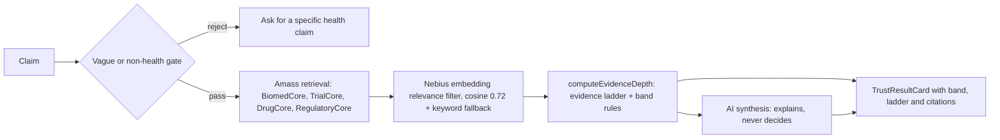

**Stack:** TanStack Start (SSR) · React 19 · TypeScript · TanStack Router + Query · Tailwind 4 · Radix / shadcn · Vite · bun · Zod · Amass scientific database · Nebius embeddings · Vercel AI SDK · Lovable

**Repo:** [github.com/PranavC225/trustspan](https://github.com/PranavC225/trustspan)

**Live demo:** [evidence-check-clarity.lovable.app](https://evidence-check-clarity.lovable.app/)

**Event:** Longevity x AI Hackathon Stockholm 2026: 16 teams, 80+ participants, 36 hours. Team of six; I was the AI Engineer. We presented live to the jury.

## Problem

Longevity advice spreads faster than the evidence behind it. A claim like "creatine keeps you strong as you age" and a claim like "crystal water reverses aging" reach people through the same feeds, in the same confident tone. Most readers have no quick way to tell whether a claim rests on human trials, a few mouse studies, or nothing at all.

## Approach

TrustSpan answers one question for a pasted claim: how deep does the evidence go?

- A gate rejects claims that are too vague to check, or that are not about health at all, before any search runs.
- The claim is searched across four linked scientific databases through Amass: publications (BiomedCore), clinical trials (TrialCore), drugs (DrugCore) and regulatory records (RegulatoryCore).
- Each retrieved record is filtered for relevance with Nebius embeddings (cosine similarity threshold 0.72, with a keyword fallback).
- A deterministic function, `computeEvidenceDepth`, places the surviving evidence on a ladder (cell studies, animal studies, observational studies, human trials) and assigns a band: Strong, Moderate, Preliminary, Anecdotal or Unproven.
- The bands are explicit rules, not model judgment. Strong needs at least two completed on-topic randomised controlled trials from at least two different sponsors. Moderate needs at least one completed on-topic RCT, or at least two RCT publications plus at least one registered trial.
- An LLM writes a short plain-language synthesis with citations. It explains the band; it does not decide it.

## Architecture

**Flow:** the gate and the band rules are plain TypeScript, so the same evidence always produces the same rating. Retrieval, relevance filtering and synthesis run in one TanStack Start server function (`checkEvidence`, built with `createServerFn`). The LLM sits at the end of the chain and only turns the already-decided rating and its citations into readable text.

## Why this stack

- **Amass:** one API over linked publications, trials, drugs and regulatory records, so a single claim can be checked against several kinds of evidence without stitching together PubMed and ClinicalTrials.gov by hand.
- **Deterministic scoring:** a rating that changes when you ask twice is worse than no rating. Rules make the band reproducible and explainable.
- **Embedding filter:** keyword search alone pulls in records that share a word with the claim but are about something else.
- **TanStack Start + Lovable:** Lovable gave us a working React scaffold fast, which matters in a 36-hour event, and TanStack Start's server functions kept retrieval on the server.

## Results

The landing page:

{: .align-center width="600"}

A real query, "Does creatine improve muscle strength in older adults?", rated Strong: 15 studies, 10 of them human trials, 320 citations:

{: .align-center width="600"}

We tested it on six or more live queries during the event. There was no formal evaluation set.

## What I learned

- **The band and the explanation can disagree.** After the event I ran nonsense claims through the live app (moon-charged crystal water, sleeping under a copper pyramid, quantum energy pendants, hexagonal water). The deterministic band rated them Moderate, while the AI synthesis correctly said there was no sufficient evidence. My best guess, not yet verified, is that generic topic words like "aging" let unrelated trials through the relevance filter, and the band rules then counted them.
- **Deterministic does not mean correct.** Rules make a rating reproducible, but they are only as good as the evidence they are fed. A claim-specific relevance check before scoring, and a set of adversarial test claims run on every change, would have caught this before the demo.
