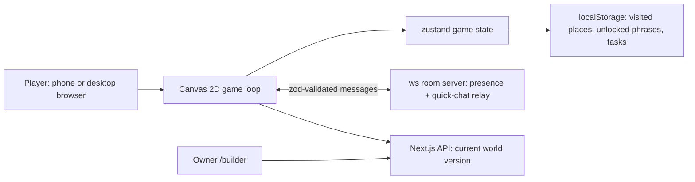

**Stack:** Next.js 14 (App Router, JavaScript) · React 18 · Tailwind · zustand · Canvas 2D · Node `ws` WebSocket server · zod · vitest · Playwright · Docker

**Repo:** private team repository

**Live demo:** no longer online. A teammate hosted it for the event.

**Event:** Uniplay Hackathon, Stockholm, 2026-09-28, one day (8:30 to 20:30), pitched live to the jury. The brief: the game has to teach something, and it has to work on a phone. Team of four.
<!-- TODO: confirm teammate names and credits before naming them -->

## Problem

People who move to Sweden learn tourist Swedish first: hello, thank you, a coffee please. What they need in the first months is the Swedish of daily life: asking for a bag at the checkout, returning bottles at the pant machine, reading metro signs, telling a pharmacist you feel unwell. Apps teach the words out of context; the city is where the words are used.

## Approach

The game is a small Stockholm you walk through. Every place teaches the Swedish you would need there.

- **A walkable map** with 11 landmarks (IKEA, ICA, Avicii Arena, KTH, Volvo Cars, Spotify, Saab, Klarna, Skansen, Lovable, Apoteket), seven metro stations with green, red and blue line signage and a schematic map, and six commuters walking around.
- **Places you can enter:** Skansen is a walkable museum with lessons on Swedish animal names and a drag-and-drop matching game. ICA has a store interior with a shopping list in Swedish and a pant machine.
- **A reason to explore:** 26 Red Bull cans are scattered across the map. Each is worth 2 kr in deposit (pant) at ICA.
- **A story:** a short intro takes the player from creating a character, through a library prologue, to arriving at Skansen.
- **Controls for both screens:** WASD or arrow keys on desktop. On a phone, tap the upper half of the screen to walk there, or use a floating joystick in the lower half.
- **Quick-chat between players** that only uses preset phrases. A phrase unlocks when you visit the place it belongs to: "Kan jag få en påse?" (can I have a bag?) at ICA, "Jag mår inte bra." (I don't feel well) at Apoteket, "Titta, en älg!" (look, a moose!) at Skansen.
- **An owner-only world builder** at `/builder` to move places, paint paths, add trees and publish a new version of the world to connected players.

Progress (visited places, unlocked phrases, finished tasks) is saved in the browser's `localStorage`, so there is no account to create.

## My part

This was a four-person build. The parts I wrote:

- **The ICA store:** the walk-in interior and the shopping mini-game, plus doors you walk through to enter and leave buildings.
- **Multiplayer presence and quick-chat:** a Node WebSocket room server, a shared zod message protocol, the preset phrase list with its unlock rules, the client hook and the chat UI. The room server has unit tests, and a Playwright test runs the multiplayer flow end to end.
- **Characters:** the character sprites, and a script that slices sprite sheets into walking and idle animation frames and a dialog portrait.
- **Developer setup:** a local `docker-compose` for the web app and the WebSocket server, and the repo's `CLAUDE.md` instructions for coding agents.

## Architecture

**Flow:** the game runs in the browser on a Canvas 2D loop, with game state in a zustand store and progress in `localStorage`. The world (places, paths, trees, spawn point) is data, not code: the owner edits it in `/builder` and publishes a new version through the Next.js API, and connected players pick it up. A separate WebSocket server keeps a room of players and relays quick-chat. Client and server check every message against the same zod schema, and a chat message carries only a phrase ID, never free text.

## Why this stack

- **Canvas 2D, no game engine:** a top-down pixel-art map with sprites does not need an engine, and a single canvas works the same in a phone browser and on desktop.
- **Next.js:** one app serves the game, the builder and the world API.
- **Preset phrases instead of free-text chat:** players can talk to each other in Swedish without anyone having to moderate what they write, and each phrase doubles as something the player has learned.
- **Shared zod protocol:** client and server import the same schema, so a malformed or unknown message is rejected instead of reaching other players.

## Results

All screenshots are from a phone-sized viewport.

The opening screen: name your character and pick a hero.

{: .align-center width="380"}

The town: two metro stations (T-Centralen and Gamla stan) with their line colours, deposit cans on the path, the station info card and the quick-chat bar ("Säg...").

{: .align-center width="380"}

Inside ICA: the shopping list is in Swedish (bröd, mjölk, ägg, ost, äpple, banan), and the player walks to the shelves to collect each item.

{: .align-center width="380"}

The place list: select a place and the player walks there.

{: .align-center width="380"}

When I took these screenshots after the event, the quick-chat bar showed "Offline" because the WebSocket server was not running in that setup.

## What I learned

- **Constraints can remove whole problems.** Limiting chat to preset phrases took moderation out of scope entirely, and turned chat into part of the lesson.
- **Make the world data, not code.** Keeping places and paths in a published world file, edited through `/builder`, separates building the map from building the game.
- **Test on the screen the brief names.** The brief said phones, so the Playwright tests run on a phone viewport as well as desktop.
- **One schema for both ends.** Sharing the message protocol between client and server means the client and the server cannot drift apart without a test noticing.
