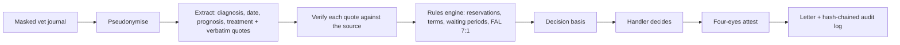

**Stack:** Node.js · vanilla JS workbench · rules engine in plain JavaScript · OpenAI-compatible LLM endpoint (configurable) · vision-model OCR · scrypt auth · SHA-256 hash-chained audit log · OpenAPI (Pega integration) · Docker

**Repo:** private team repository

**Event:** Vivicta hackathon, challenge set by Folksam, pet insurance line. Presented on 2026-09-21. Team of five; I owned the scope, the L1 architecture, the evaluation harness and the five-minute narrative, and held the veto on what got cut.

## Problem

Folksam's brief, verbatim: *"Use AI to extract key risk indicators from veterinary records and recommend potential insurance exclusions (reservations) based on underwriting guidelines."*

Underwriters read long veterinary journals full of Swedish clinical shorthand to decide whether a pet's earlier conditions should become reservations on the policy. It is slow, and the reasoning behind each reservation lives in the handler's head instead of on the record.

## Approach

The first decision was a reframe, not a model choice. Folksam does not generally decline cover: it grants cover with reservations, priced to risk. So the system never outputs a rejection. Every outcome is one of: grant with no reservations, grant with reservations (each one listed), or refer to an underwriter.

The second decision was a strict division of labour, which is also the answer to GDPR article 22 and the EU AI Act:

- **The AI reads.** It extracts the diagnoses, diagnosis dates, prognosis and treatment from the journal. Every extracted line carries the verbatim quote it came from, and each quote is verified against the source text.
- **The rules decide.** A deterministic rules engine maps diagnoses to reservations from the underwriting guidelines, in the brief's fixed form "*condition* and any resulting complications". The same engine checks claims against the insurance terms and the policy's reservations: waiting periods, pre-existing conditions, and the payment deadlines and interest rules in the Swedish Insurance Contracts Act (FAL 7:1).
- **A person signs.** The handler sees a decision basis, makes the decision, and a second person attests it (four-eyes) before a letter is generated.

Around that core we built:

- pseudonymisation of the journal before any model sees it
- an offline Swedish extractor, so the whole system runs without an API key
- vision-model OCR for scanned journals, with the handler confirming the transcribed text
- an underwriting risk engine that sets reservations from a guideline table
- an archive that stores each generated PDF with its SHA-256 hash
- local login (scrypt, locks after five failed attempts)
- a Pega integration: an OpenAPI spec (`POST /api/pega/analyze`, `/api/pega/cases/{id}/letter`) and a Pega GenAI Blueprint
- a workbench UI styled after Folksam's Case1 handler environment

## Architecture

**Flow:** the model's only job is reading. Everything that affects the outcome (which conditions become reservations, whether a claim is covered, when payment is due) is plain JavaScript, with the source quote, the policy clause and the legal reference attached to each result. Decisions go into an audit log where each entry carries the hash of the previous one, so a changed record breaks the chain.

## Why this stack

- **Rules over model judgment:** an underwriting decision has to be explainable to the customer and to a regulator. A lookup from the guidelines, with the quote that triggered it, is explainable; a model score is not.
- **Configurable LLM endpoint:** any OpenAI-compatible chat-completions API works, so the insurer can point it at whatever provider its data processing agreements allow, or run fully offline.
- **Vanilla JS workbench:** it mirrors the handler's Case1 environment, so the demo shows where the system fits instead of asking people to imagine a new tool.
- **OpenAPI + Pega Blueprint:** Case1 is Pega-style, so the integration path needed to be concrete, not a slide.

## Results

The login screen of the proof of concept. It locks after five failed attempts:

{: .align-center width="600"}

The legal framework page, which maps each step of the pipeline to the rules it has to respect: FAL, Finansinspektionen's regulations (FFFS), GDPR, the EU AI Act and the Swedish Board of Agriculture's regulations (SJVFS):

{: .align-center width="600"}

The Pega integration page, with the API endpoints and the GenAI Blueprint:

{: .align-center width="600"}

On Folksam's labelled samples, the system recommended 2 of 3 expert reservations on one sample journal, and none on a second where the expert set none. That is two journals, not an evaluation.

## What I learned

Most of the hard problems were in the documents, not the model:

- A multi-year record was at first read as a single visit, which made old, resolved conditions look current.
- Records mixed two diagnosis coding systems, so the same condition could appear under two codes.
- An invoice line that wrapped onto a second line lost its amount during extraction.
- A rule of the form "every invoice line must satisfy X" passed on an empty invoice. Vacuous truth is a real bug in rules engines.
- Our pseudonymiser missed staff titles, and the masking in the supplied documents missed some names. Masking needs its own test set, not a quick check by eye.
